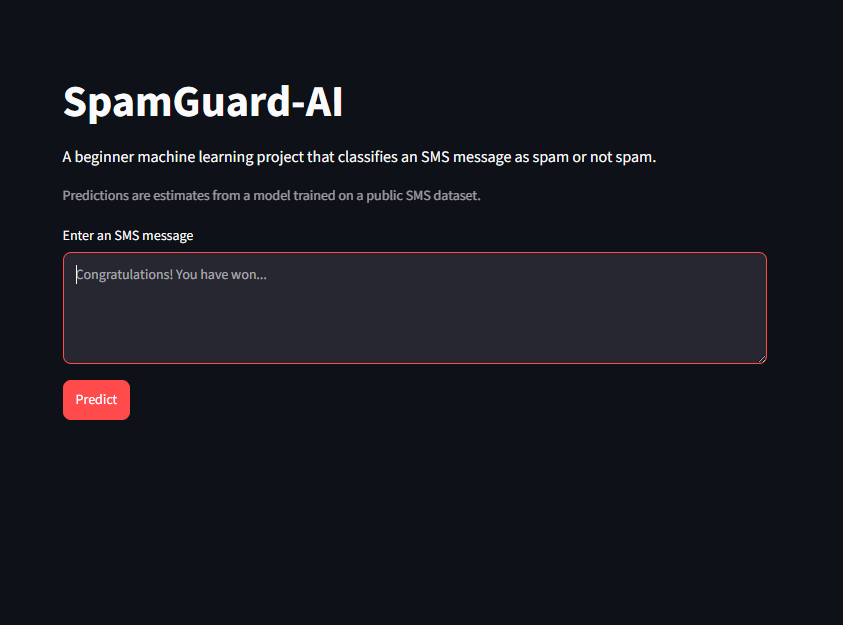
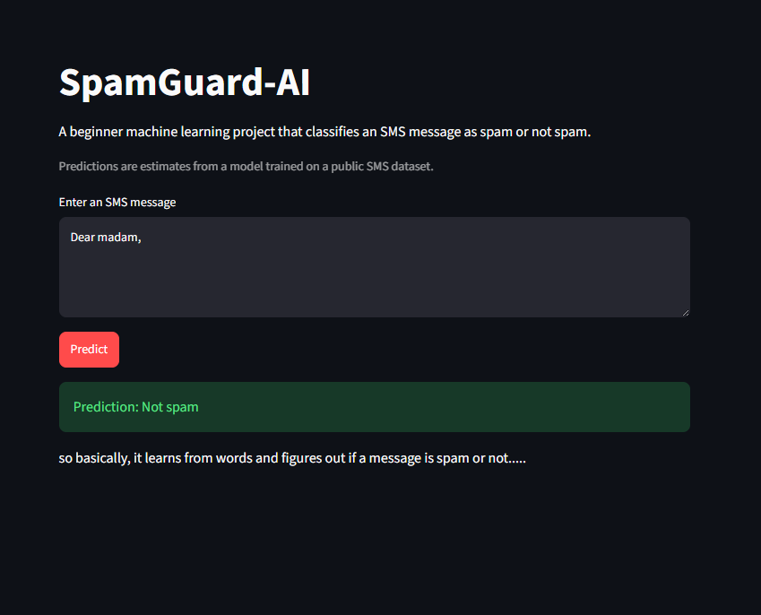
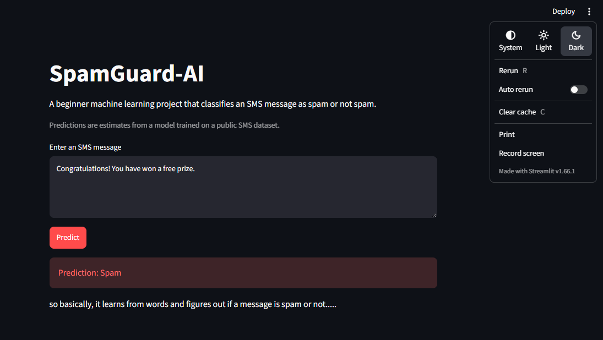

# SpamGuard-AI 

## 1. About the Project

This is one of my Machine Learning projects where I explored how AI can identify spam messages.

We've all received unwanted SMS messages, from random advertisements to suspicious messages that might be scams. So, I wanted to understand how a Machine Learning model can recognise the difference between a normal message and spam.

For this project, I used the SMS Spam Collection dataset and built a text classification model that predicts whether a message is **Spam** or **Ham (Not Spam)**.

I also created a simple Streamlit application where I can enter a message and see what the model predicts.

## 2. Why I Built This Project

I wanted to explore Natural Language Processing (NLP) and understand how computers can work with human language.

I was curious about a few things:

- How can a computer understand the text inside an SMS?
- How can a model recognise suspicious or unwanted messages?
- How do we convert normal text into something a Machine Learning model can understand?
- How can we train a model to classify messages automatically?

Instead of just reading about text classification, I decided to build a small project and try it myself.

## 3. What I Built

Here's what I worked on:

- **Dataset Collection:** Downloaded the SMS Spam Collection dataset from the UCI Machine Learning Repository.
- **Text Preprocessing:** Cleaned and prepared SMS messages before training.
- **Text Vectorisation:** Used TF-IDF to convert text messages into numerical features.
- **Machine Learning Model:** Trained a Multinomial Naive Bayes classifier to identify spam and normal messages.
- **Model Evaluation:** Checked the model using accuracy, precision, recall, F1-score, and a confusion matrix.
- **Model Saving:** Used Joblib to save the trained model so I could reuse it without training again.
- **Prediction Application:** Built a simple Streamlit interface to enter messages and check their predictions.

## 4. Technologies I Used

- **Python** – Main programming language.
- **Pandas** – To load and explore the dataset.
- **Scikit-learn** – To prepare text data, train the model, and evaluate predictions.
- **TF-IDF** – To convert text messages into numerical features.
- **Multinomial Naive Bayes** – The Machine Learning algorithm used for classification.
- **Joblib** – To save and load the trained model.
- **Streamlit** – To build the interactive prediction application.

## 5. Project Structure

Here's how I organised the project:

- `download_data.py` – Downloads the SMS Spam Collection dataset.
- `text_preprocessing.py` – Cleans and prepares text messages.
- `train_model.py` – Trains the model and evaluates its performance.
- `predict.py` – Loads the saved model and makes predictions.
- `app.py` – Runs the Streamlit application.
- `requirements.txt` – Contains the required Python libraries.
- `screenshots/` – Contains screenshots of the application.

## 6. How to Install

First, make sure Python 3.10 or later is installed.

Clone the repository:

```bash
git clone YOUR_REPOSITORY_URL
cd SpamGuard-AI
```

Create a virtual environment:

```bash
python -m venv .venv
```

Activate it:

**Windows:**
```bash
.venv\Scripts\activate
```

**macOS/Linux:**
```bash
source .venv/bin/activate
```

Install the required libraries:

```bash
pip install -r requirements.txt
```

## 7. How to Run

**Step 1 – Train the Machine Learning model**

```bash
python train_model.py
```

The dataset is downloaded from UCI during the first training process, so an internet connection is required.

**Step 2 – Start the Streamlit application**

```bash
streamlit run app.py
```

Now, the application should open in your browser.

Enter an SMS message and let the model predict whether it's spam or not.

## 8. How It Works

This is where things get interesting!

A computer doesn't understand text in the same way we do. So, before training the model, I needed to convert the messages into numerical data.

Here's the process I explored:

**1. Collecting the Data**

First, I downloaded the SMS Spam Collection dataset. It contains messages labelled as `spam` or `ham`.

**2. Cleaning the Text**

I used text preprocessing to prepare the messages and make them suitable for the model.

**3. Converting Text into Numbers**

I used TF-IDF (Term Frequency-Inverse Document Frequency).

Basically, TF-IDF converts words into numerical values based on how important they are within the collection of messages.

**4. Training the Model**

I used Multinomial Naive Bayes to learn patterns from the training messages and classify new messages.

**5. Testing the Model**

I evaluated the model using different metrics:

- **Accuracy:** How many predictions were correct overall.
- **Precision:** How many messages predicted as spam were actually spam.
- **Recall:** How many actual spam messages the model successfully identified.
- **F1-score:** A balance between precision and recall.
- **Confusion Matrix:** Helps me understand correct and incorrect predictions for both classes.

**6. Making Predictions**

Finally, I saved the trained model using Joblib and connected it to Streamlit.

Now I can enter a new SMS message and see the model's prediction through the application.

## 9. Screenshots

Here's a look at my SpamGuard-AI application.

**Application Interface**



**Message Prediction**



**Additional Application View**



## 10. What I Learned

This project helped me understand how Machine Learning can be used with text data and how a basic NLP workflow works.

Here are some things I learned:

- How to work with a real-world text classification dataset.
- How to clean and preprocess text messages.
- What NLP is and why it is useful.
- How TF-IDF converts text into numerical features.
- How Multinomial Naive Bayes works for text classification.
- How to split data into training and testing sets.
- How to evaluate a classification model using different metrics.
- Why precision and recall are important when detecting spam.
- How to save and reuse a trained Machine Learning model.
- How to connect a Machine Learning model to a Streamlit application.

**The biggest thing I learned:** Machine Learning isn't just about feeding data into an algorithm. Preparing the data and choosing the right way to represent it can make a big difference in how the model performs.

I also got a better understanding of how NLP connects human language with Machine Learning.

## 11. Limitations

There are still some limitations:

- The dataset contains historical SMS messages and may not represent today's spam and scam messages.
- The model may not recognise every new type of spam.
- Different languages and regional expressions may affect prediction accuracy.
- Some genuine messages might be classified as spam, and some spam messages might be missed.

This is a learning project, not a professional spam protection or security system. Predictions should not be treated as guaranteed results.

## 12. Future Improvements

I'd like to explore more ideas and improve this project further:

- Try other Machine Learning algorithms and compare their performance.
- Experiment with different text vectorisation techniques.
- Use cross-validation to evaluate the model more reliably.
- Explore larger and more recent SMS spam datasets.
- Add multilingual message support.
- Improve the Streamlit interface.
- Explore more advanced NLP techniques and Deep Learning models.

## 13. Dataset Credits

**Dataset:** SMS Spam Collection

**Source:** UCI Machine Learning Repository

https://archive.ics.uci.edu/dataset/228/sms+spam+collection

The dataset is provided by the UCI Machine Learning Repository. Please refer to the original dataset page for citation and usage information.

---

*Another project, another concept explored. Learning how AI understands text, one message at a time. 🚀*
